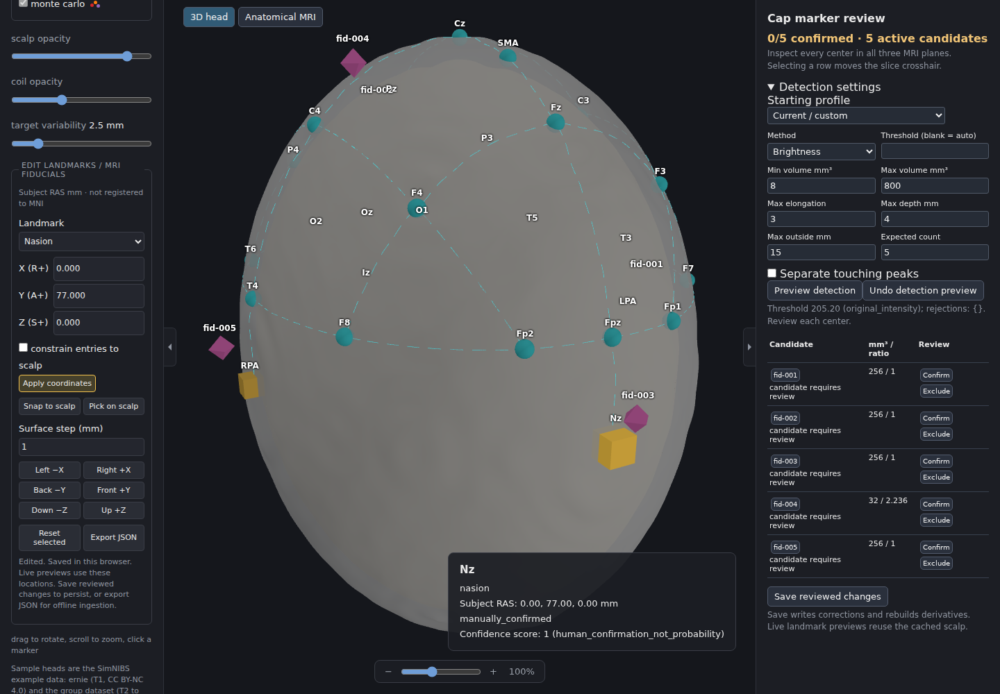
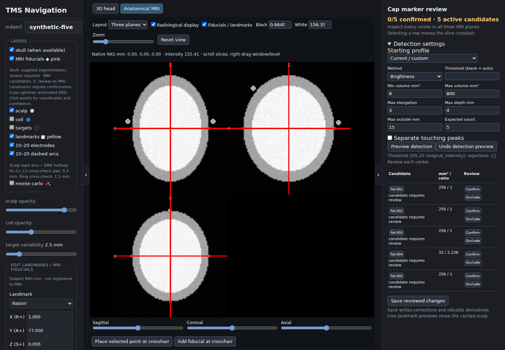

# Latest changes: MRI inspection and five-marker cap review

**2026-10-22** · Long-term setup and usage: [subject-reconstruction.md](subject-reconstruction.md).

## Delivered

| Area | Change |
|---|---|
| Anatomical MRI | NiiVue linked slices, sliders, crosshairs, intensity readout, contrast, zoom and orientation controls |
| Point editing | Slice/3D selection synchronization; crosshair placement; manual fiducial addition |
| Missing markers | Per-component size, shape, scalp distance/depth and explicit rejection reasons |
| Detection | Bright/local-contrast modes, physical filters, optional touching-peak separation and undoable previews |
| LiquiMark | Review-required starting profile for the user-specified 8 mm round markers |
| Review completion | Confirm/exclude controls; confirmed/expected and active-candidate counts; no forced top-five selection |
| EEG | Cached, debounced landmark-driven recomputation; provisional confidence for unconfirmed anchors |
| Persistence | Save reviewed corrections/settings; reopen saved derivatives; reuse existing registration |
| MNI | Pink fiducial rendering and control hidden; existing MNI visualization preserved |
| Documentation | Usage consolidated in the existing guide; report limited to latest changes/results; brief AGENTS.md policy added |

## A concrete detection failure found and fixed

- Five synthetic markers had unequal intensities.
- The faintest sphere occupied one voxel plane after thresholding.
- A point-only covariance estimate incorrectly rejected it as elongated: **4/5** candidates.
- Including finite voxel-box variance recovered the fifth candidate: **5/5**.
- Additional tests cover reflected/oblique grids, local contrast, touching peaks and zero detections.
- This explains one demonstrated synthetic failure; it does **not** establish the cause on the restricted acquisition.

## Verified results

| Check | Result |
|---|---|
| Python suite | **75 passed** |
| JavaScript unit tests | **8 passed** |
| Chromium/WebGL workflows | **2 passed**: MRI/review/save/reopen and MNI/subject regression |
| Production viewer | Build passed with NiiVue and Parcel package-exports support |
| Environment | `pip check` passed; existing Python 3.12 / Node 22 environment retained |
| Diff hygiene | `git diff --check` passed |

Coverage includes:

- Native image bytes/affine/unit alignment, marker centers and provisional EEG confidence.
- Cached surface reuse for previews; changed electrodes after landmark movement.
- Saved corrections and reopening, stable detector identity across Python/browser numeric types.
- Existing registration reuse during save; exact source identity and invalid-point rejection.
- Loopback Host/Origin restrictions and bounded JSON requests.
- Slice navigation/overlays, manual marker placement, rejection review, MNI-only behavior and subject switching.
- Retained WebGL frames prevent partial QC captures after reset; slice-pixel checks cover both halves of the phantom.

## Visual review — synthetic data only

## Limits and operational notes

- Restricted subject scans were not accessed or validated. No further scan search is authorized.
- The LiquiMark profile is a starting configuration, not calibrated acquisition-specific detection.
- Expected count five remains a review expectation; each accepted center needs visible MRI support.
- Live previews reuse the scalp. Explicit save rebuilds reusable derivatives; existing MNI registration is reused.
- The local API is required for MRI/live operations. Static viewing remains available without it.
- Initial software-WebGL shader compilation can be slower than GPU-backed viewing; hidden 3D rendering pauses in the MRI tab.
- Existing `gh-pages` dependency audit findings remain outside this change.
