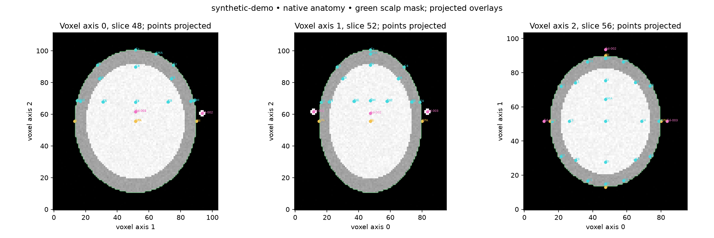

# Subject reconstruction delivery report

Completed 2026-10-21. Usage and correction/transform formats are documented in
[the complete workflow](subject-reconstruction.md).

## Implemented

- Separate reusable `src.subject_ingest` module and `ingest_subject.py` CLI,
  accepting subject ID, native anatomical T1w and optional corrections,
  physical affine transform, MNI registration reference or validated skull mask.
- Dedicated default `saves/subjects/<ID>/T1w.nii[.gz]` inputs, content-addressed
  per-subject caching, derivative checksums, staged replacement and writer locks.
  Original inputs remain unchanged. Legacy non-template ingestion uses this path too.
- Bright superficial MRI marker candidate detection with weighted 3D centers,
  morphology/contrast confidence scores and explicit unresolved identities.
  Proximity labels are suggestions supported by confirmed anatomy/electrodes.
- Subject scalp reconstruction, optional separate skull surface from supplied
  segmentation, native coordinates/meshes, confidence/status and transform
  provenance, coordinate tables and slice QC for every marker and landmark.
- Anatomical landmark proposals flagged underdetermined; scalp 10–20 constructions
  withheld until Nz, Iz, LPA and RPA are confirmed. Arc disagreement is retained.
- Subject viewer integration with pink fiducial diamonds, yellow landmark cubes,
  cyan electrode spheres, independent overlays, optional skull, selection and
  native/secondary-MNI coordinate inspection. Subjects never load Monte Carlo
  samples or placeholder targets. MNI retains its demo functionality and default.
- Browser corrections persist per subject and export source/detection-bound JSON.
  Applying saved corrections rebuilds the corresponding subject derivatives and
  electrode construction. Detector changes cannot silently redirect old exclusions.
- Explicit RAS/LPS conversion, forward/reverse physical affine support, strict
  native-header validation, deterministic optional T1w-to-MNI affine registration
  and saved registration review artifacts.

## Environment and verification

Created `/home/ab126/micromamba/envs/tms312`, with Python **3.12.15** and Node
**22.23.2**. Installed all Python project/development dependencies, SimpleITK,
locked viewer dependencies, Playwright Chromium, and the user-local Linux audio
library needed by Chromium. `python -m pip check` reports no broken requirements.
The environment specification and installed Python versions are saved in
`environment.yml` and `requirements-tms312-lock.txt`.

| Verification | Result |
| --- | --- |
| `micromamba run -n tms312 python -m pytest tests/ -q` | **66 passed** |
| `cd viewer && micromamba run -n tms312 npm test` | **8 passed** |
| `cd viewer && micromamba run -n tms312 npm run test:browser` | **1 passed** in Chromium with software WebGL |
| `cd viewer && micromamba run -n tms312 npm run build` | Production build passed |
| `python run_pipeline.py --template` in tms312 | Downloaded/cached full-head MNI, rebuilt surfaces, previews, EEG and Monte Carlo assets |
| Repeated real ingestion command against synthetic-demo | Cache reused; no reconstruction |
| Actual browser-exported correction applied through Python in isolated derivatives | Edited marker retained; 22 electrodes recomputed |
| `git diff --check` | Passed |

Tests cover bright-marker centers, no-marker behavior, reflected/oblique affines,
unit conversion and ambiguous headers, forward/reverse RAS/LPS affine chains,
known physical translation registration, anisotropic/rotated/reflected/translated
surface alignment, source/detection identity checks, skull grid/containment,
correction recomputation, cache corruption and previous-output preservation.
The browser test switches MNI → subject → MNI, toggles overlays, edits a marker,
exports corrections and restores browser edits without JavaScript errors.

## Demonstration and visual QC

No real subject T1w or acquisition-specific MRI marker data was present in the
repository. The subject demonstration is explicitly synthetic. It uses a 2 mm
ellipsoid phantom containing three bright spheres, construction-truth anchors
supplied as manual corrections, and a synthetic skull shell supplied separately.
These are not detections of human anatomical landmarks.

All three bright spheres were detected. The aligned-grid centers matched their
construction centers to numerical precision. With reflected/oblique voxel axes,
localization errors were **0.205, 0.205 and 0.115 mm**. The phantom yielded **22**
scalp sites (19 conventional electrodes plus Fpz/Oz and SMA). Its sagittal/coronal
Cz construction gap was **0.002 mm**; this is numerical agreement on a regular
phantom, not real-world anatomical accuracy or a localization uncertainty bound.




Regenerate on a fresh checkout:

```bash
micromamba create -y -f environment.yml
eval "$(micromamba shell hook --shell bash)"
micromamba activate tms312
python run_pipeline.py --template
python scripts/synthetic_subject_demo.py
cd viewer
npm ci
npx playwright install chromium
npm test
npm run test:browser
npm run dev
```

The demo refuses to overwrite an existing input. To reuse the existing demo and
its generated truth corrections:

```bash
python ingest_subject.py synthetic-demo \
  --corrections saves/subjects/synthetic-demo/synthetic_anchor_corrections.json \
  --skull-mask saves/subjects/synthetic-demo/synthetic_skull_mask.nii.gz
```

For a real subject, run `python ingest_subject.py sub-001 /path/to/native_T1w.nii.gz`,
review the saved MRI slices, confirm/correct anchors in the viewer, export
`saves/subjects/sub-001/corrections.json`, and rerun ingestion. See the usage guide
for registration commands and the full derivative structure.

## Remaining limitations

- Marker detection is conservative and unvalidated on real acquisitions. Bright
  compact superficial candidates can include false positives; dark, touching,
  deep or atypical markers can be missed. Scores are not calibrated probabilities.
- Unknown acquisition/cap protocols cannot justify exact automatic electrode
  identities. Unconfirmed anatomical anchors withhold the EEG cap. Large head
  tilt, defacing/cropping and segmentation artifacts require manual review.
- T1 alone does not produce a reliable skull segmentation. The optional skull
  path requires a separately validated binary mask; grid/containment checks do
  not validate the underlying tissue labels.
- Registration is affine, needs an explicit reference and visual review, and is
  not nonlinear normalization. Ambiguous raw FSL/ITK/ANTs matrices and nonlinear
  warps need explicit conversion outside this importer.
- Browser edits require exporting JSON and rerunning ingestion; there is no local
  write-enabled viewer server. Concurrent different-subject exports share a static
  registry; run ingestion serially. Process termination may leave a lock or backup
  requiring the documented recovery step.
- `npm audit` reports five existing high-severity findings in the `gh-pages`
  deployment dependency chain (`gh-pages`, `globby`, `fast-glob`, `micromatch`,
  `braces`). The project dependency versions in that chain were unchanged.
  This does not block the local viewer build/tests; deployment dependency updates
  remain separate work.
